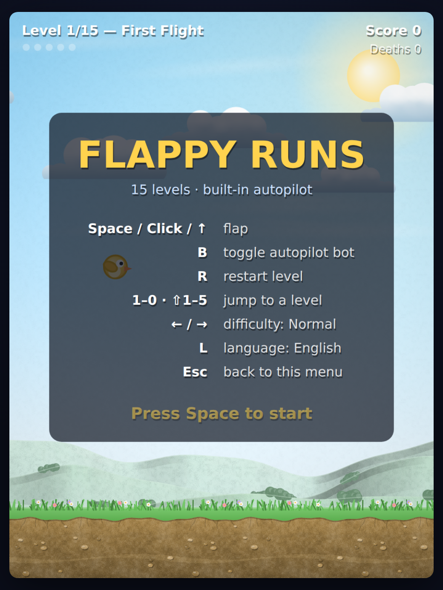
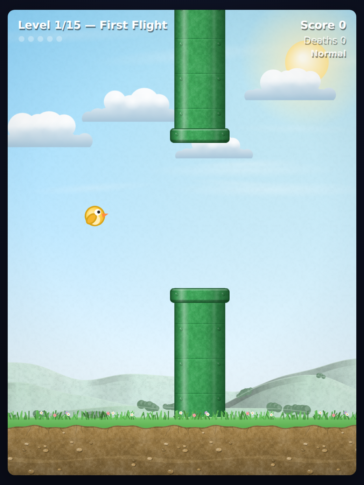
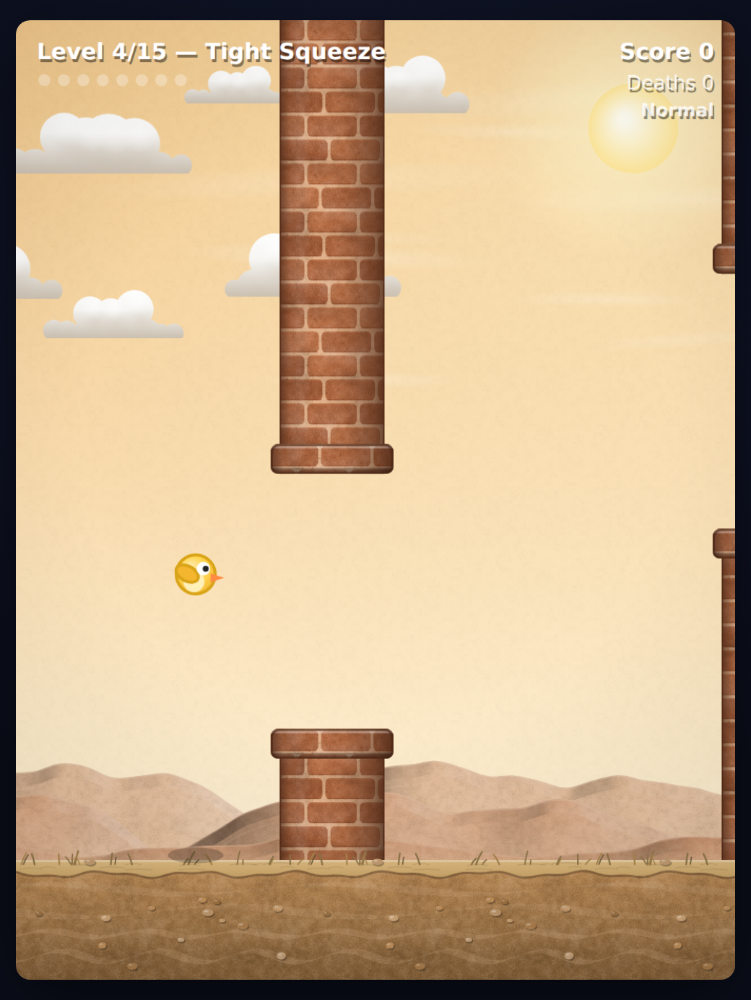
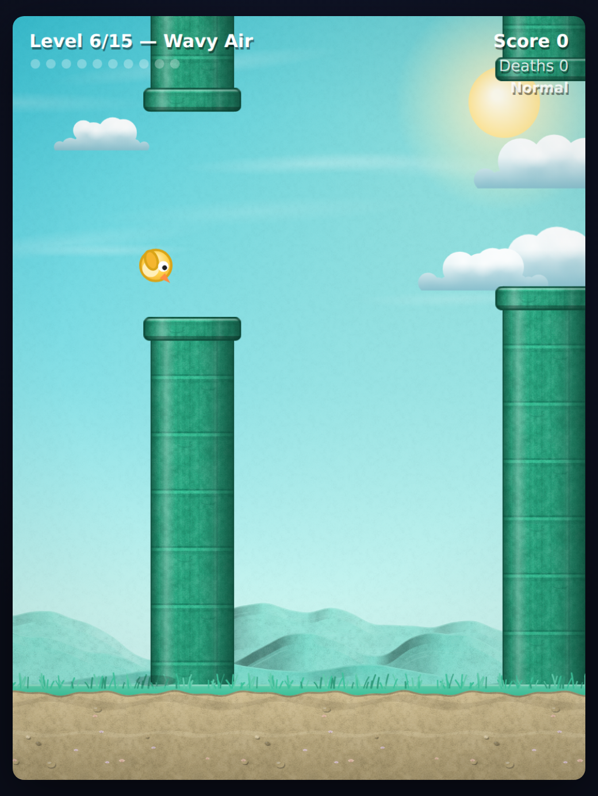
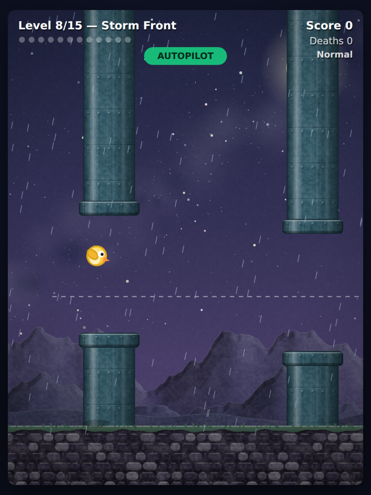
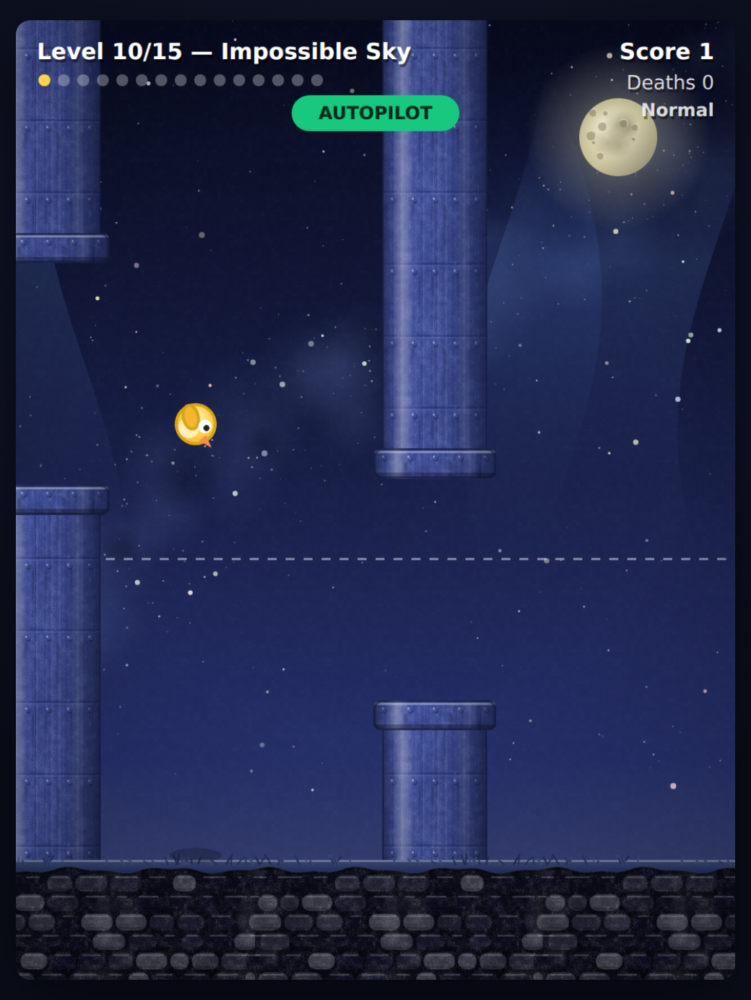
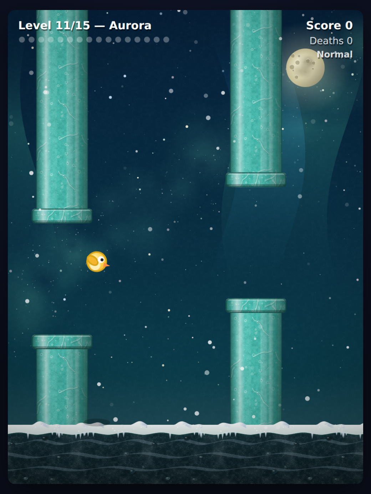
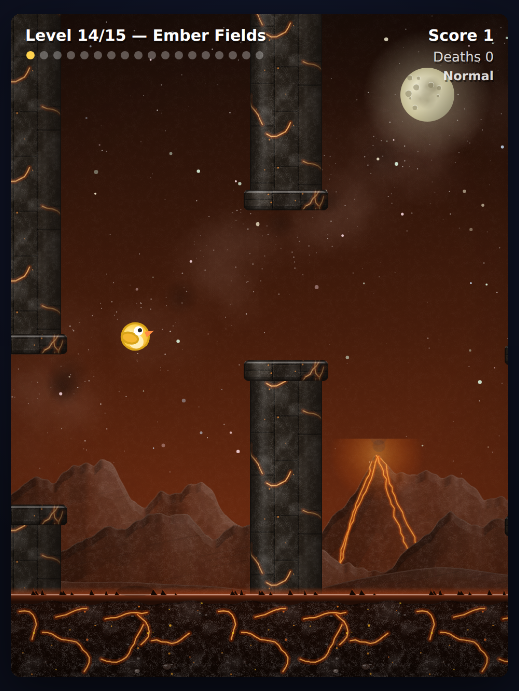
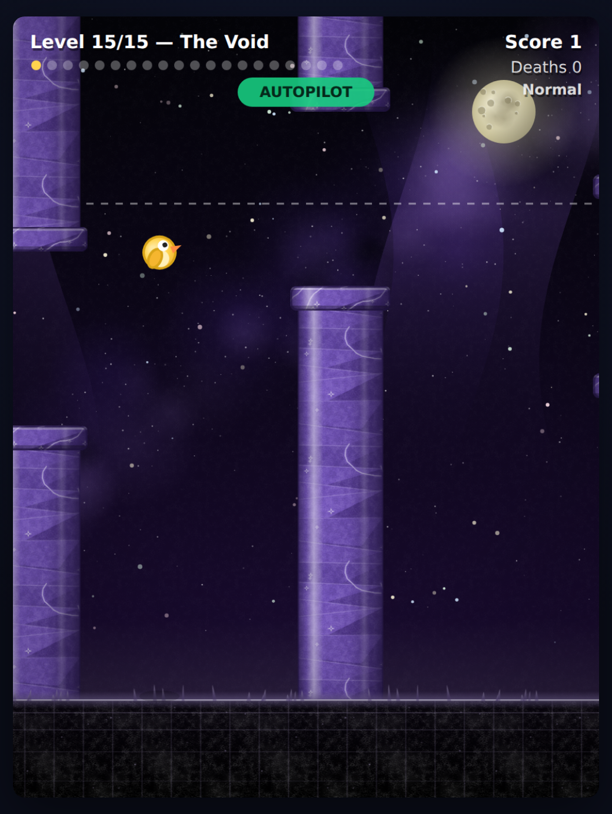

# Flappy Runs

A Flappy-Bird-style game built from scratch with [Bun](https://bun.sh), TypeScript and
canvas — no frameworks, no runtime dependencies. Fifteen handcrafted levels and a built-in
autopilot bot that can clear the whole campaign (proven by the test suite).

<p align="center">
  
  
  
</p>
<p align="center">
  
  
  
</p>
<p align="center">
  
  
  
</p>

## Run it

```sh
bun install   # dev types only
bun run dev   # serve with hot reload → http://localhost:3000
```

`bun run start` serves a production build without hot reload. Both listen on `localhost`
only; set `HOST=0.0.0.0` to reach the game from other devices (e.g. a phone on your LAN),
and `PORT` to change the port.

## Controls

| Input                  | Action                          |
| ---------------------- | ------------------------------- |
| `Space` / click / `↑`  | flap (also start / retry)       |
| `←` / `→`              | lower / raise difficulty        |
| `L`                    | switch language                 |
| `B`                    | toggle the autopilot bot        |
| `R`                    | restart the current level       |
| `1`–`9`, `0`           | jump straight to a level (0 = 10) |
| `⇧`+`1`–`5`            | jump to levels 11–15            |
| `Esc`                  | back to the menu                |

## The 15 levels

Difficulty ramps via gap size, scroll speed, pipe spacing and — from level 6 — vertically
oscillating gaps. Every level has its own scenery, running roughly from morning through
dawn, midday, desert, sunset and lagoon, into rain, then night: Storm Front, Night Run and
Impossible Sky, then Aurora (snow + aurora curtains), Crimson Dusk, Frostbite (whiteout
blizzard), Ember Fields (volcanic) and The Void. Sky gradient, pipe and ground colours,
parallax hills, weather and aurora are all per-level fields — they're purely cosmetic, so
re-theming a level never changes its layout. Layouts are seeded and deterministic
(`src/levels.ts`).

Each level also picks a pipe material (`pipeStyle`: enamel, bamboo, adobe, barrel wood,
mossy stone, riveted steel, copper patina, ice, brick, lava-cracked basalt, crystal) and a
`terrain` (meadow, desert, beach, marsh, rocky, snow, volcanic, void) that shapes its ground
and three-layer parallax hills — tree clumps, dunes, palms, snow caps, a smoking volcano.
These are painted procedurally into offscreen textures when a level loads (`src/textures/`),
seeded from the level so it always looks the same; frames then just tile and blit them. The
next level's textures are painted during the "level clear" pause, so play never stutters.

## Difficulty

The slider under the game (or `←`/`→`) picks one of five settings — Chill, Easy, Normal,
Hard, Brutal — and remembers it between visits. Each setting scales every level's gap,
scroll speed, oscillation and gap-to-gap jitter (`src/difficulty.ts`), so the campaign keeps
its ramp at any setting; Normal plays the levels exactly as authored. A new setting takes
effect from the next level start or retry. The late levels already push the bot near its
limit, so Hard and Brutal mostly turn up the speed; the tests check that the bot can still
clear every level at every setting.

## Languages

The menu, HUD and banners — level and difficulty names included — come in English,
Español, Français, Deutsch, Português, 日本語 and 简体中文 (`src/i18n.ts`). The game
starts in your browser's language when it's one of these; pick another from the globe
menu under the game or press `L`, and it's remembered between visits. Long translations
shrink to fit their panel rather than overflow.

## The bot

`src/bot.ts` implements a physics-based controller: it "rides" a line just above the
bottom lip of the next gap, flapping whenever its short-horizon fall prediction crosses
that line, with a guard against flapping into the top lip. For moving gaps it samples the
gap edges across its whole transit window and honors the most restrictive bounds.

Verify it yourself:

```sh
bun test             # incl. the bot clearing every level at every difficulty
bun run sim          # headless campaign run with a per-level report
bun run sim brutal   # …at a given difficulty
```

## Layout

```
server.ts            Bun.serve + HTML import (bundles the client on the fly)
public/index.html    page shell
src/engine.ts        deterministic fixed-timestep game engine (no DOM)
src/levels.ts        the 15 level definitions
src/textures/        procedural per-level textures (pipes, ground, hills, sky, clouds)
src/difficulty.ts    difficulty settings that scale the levels
src/i18n.ts          UI translations and browser-language detection
src/bot.ts           autopilot controller
src/client.ts        canvas renderer, input, level/phase flow
scripts/simulate.ts  headless bot campaign report
tests/bot.test.ts    bot + engine tests
tests/difficulty.test.ts  difficulty scaling + bot at every setting
```
